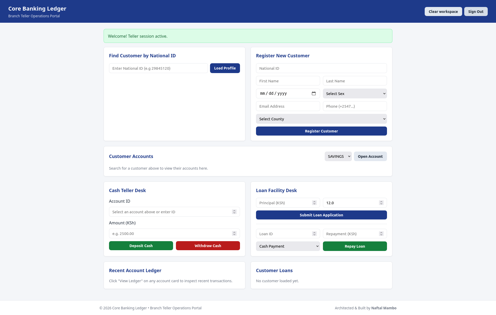
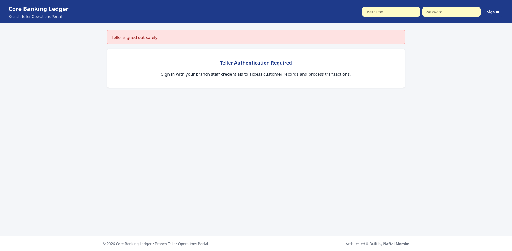

# 🏦 Core Banking Ledger System

A reliable banking system for managing customer accounts, deposits, withdrawals, and loans with exact cent-level accuracy and safe counter workflows.

## 🖥️ Overview & Problem Solved

Many cooperative societies (SACCOs), transport cooperatives, and investment groups still rely on manual ledger books or basic spreadsheets—exposing member funds to floating-point rounding drift, cross-account posting errors, unauthorized withdrawals, and delayed loan reconciliation.

**Core Banking Ledger System** solves these challenges with a defense-in-depth financial architecture:

- **Zero Floating-Point Drift:** All monetary balances, deposits, withdrawals, loan principals, and interest obligations are stored and calculated exclusively as exact **`long` integer cents** (`BIGINT` in PostgreSQL).
- **ACID-Compliant Transaction Engine:** Every deposit, minimum-balance withdrawal, loan disbursement, and loan repayment executes inside `@Transactional` service boundaries—ensuring operations either commit atomically or roll back cleanly.
- **Interest-First Loan Waterfall Engine:** Loan repayments automatically clear accrued interest before reducing principal balance, updating loan status (`ACTIVE` → `PAID`) atomically.
- **Branch-Grade Teller Operations Portal:** A single-page, session-authenticated teller interface with customer lookup by National ID, ordered account cards (`SHARES` → `SAVINGS` → `LOAN`), live transaction ledger inspection, confirmation guardrails, and one-click **Clear Workspace** customer privacy sanitization.

---

## 🏗️ Architecture

The application is built as a **3-Tier Layered Monolith** packaged into a single Spring Boot deployment, backed by a shared domain model (`domain/`):

```text
┌──────────────────────────────────────────────────────────┐
│ 1. Presentation Tier (src/main/resources/static/)        │
│    HTML5, CSS3, Vanilla JS — Teller UI & client checks   │
└────────────────────────────┬─────────────────────────────┘
                             │ REST APIs (JSON + Basic Auth)
                             ▼
┌──────────────────────────────────────────────────────────┐
│ 2. Application & Business Tier (Spring Boot)             │
│    SecurityConfig → Controllers → SaccoEngineService     │
│    (HTTP routing, auth gate & @Transactional SACCO rules)│
└────────────────────────────┬─────────────────────────────┘
                             │ Spring Data JPA / Hibernate
                             ▼
┌──────────────────────────────────────────────────────────┐
│ 3. Data Persistence Tier (repository/ + PostgreSQL)      │
│    JPA Repositories → PostgreSQL (BIGINT cents & checks) │
└──────────────────────────────────────────────────────────┘
```

1. **Presentation Tier (`static/`):** The browser-based Teller Portal (`index.html`, `style.css`, `app.js`). It validates inputs early, asks for teller confirmation before moving money, and communicates via `fetch()`.
2. **Application & Business Tier (`config/`, `controller/`, `service/`, `exception/`):** Guards endpoints with Spring Security, routes HTTP requests, handles errors cleanly via `GlobalExceptionHandler`, and runs all financial rules inside `@Transactional` blocks in `SaccoEngineService`.
3. **Data Persistence Tier (`repository/` & PostgreSQL):** Maps the shared domain entities (`SaccoMember`, `SaccoAccount`, `Loan`, `LedgerTransaction`) to four relational tables enforced by foreign keys, B-Tree indexes, and `CHECK` constraints against negative balances.

---

## 🛠️ Tech Stack

- **Backend Core:** Java 17, Spring Boot 4.1.2 (Spring Web, Spring Data JPA, Spring Security)
- **Database Engine:** PostgreSQL (`BIGINT` integer-cents storage, Foreign Keys, `CHECK` constraints, B-Tree indexes)
- **Frontend Portal:** Semantic HTML5, Modern CSS3, Vanilla ES6+ JavaScript (Zero framework overhead)
- **Testing:** JUnit 5, Mockito (`SaccoEngineServiceTest`)
- **Tooling & Environment:** Ubuntu Linux, Maven, VS Code, Git/GitHub

---

## ✨ Key Banking & Domain Rules Enforced

1. **Member Onboarding & Account Management:**
   - Unique National ID enforcement and structured Kenyan county registration.
   - Supports multiple account types per member (`SHARES`, `SAVINGS`, `LOAN`).
2. **Cash Teller Desk Guardrails:**
   - Direct counter deposits restricted to `SAVINGS` and `SHARES` accounts.
   - Direct counter withdrawals restricted strictly to `SAVINGS` accounts while enforcing a mandatory **KSh 1,000.00 minimum balance floor**.
   - Ownership verification ensuring tellers cannot post transactions against an unverified or mismatched customer account.
3. **Loan Facility & Waterfall Repayment Rules:**
   - Loan applications require an active `SAVINGS` account holding at least **KSh 75,000.00**.
   - Loan disbursement verifies active `SAVINGS` and `LOAN` accounts and credits principal directly to `SAVINGS`.
   - Loan repayments support both **Cash Payment** and **Savings Deduction** (respecting the KSh 1,000.00 minimum savings floor) using an **interest-first waterfall**.

---

## 📸 Screenshots & System Preview

### Branch Teller Operations Portal

> Single-page teller dashboard featuring customer lookup by National ID, ordered account cards (`SHARES` → `SAVINGS` → `LOAN`), Cash & Loan desks, and live ledger inspection.



### Teller Authentication & Access Gate



---

## 🗂️ Project Structure

```text
sacco-management-backend/
├── pom.xml                                         # Maven dependencies & Java 17 / Spring Boot config
├── LICENSE                                         # Open-source MIT License terms
├── README.md                                       # Project documentation
├── schema.sql                                      # Complete PostgreSQL DDL schema & constraints
├── schema/                                         # Modular SQL schema & B-Tree index definitions
│   ├── 01_members.sql
│   ├── 02_accounts.sql
│   ├── 03_transactions.sql
│   ├── 04_loans.sql
│   └── 05_index.sql
├── seeding/                                        # Initial database seed records
│   └── seed_data.sql
├── queries/                                        # Analytical & reconciliation SQL scripts
│   └── analytics.sql
├── images/                                         # UI screenshots & database architecture visuals
│   ├── balancesheetquery.png
│   ├── membertable.png
│   ├── tables.png
│   ├── teller-portal-login.png
│   └── teller-portal-workspace.png
└── src/
    ├── main/
    │   ├── java/com/sacco/
    │   │   ├── LedgerApplication.java              # Spring Boot application entry point
    │   │   ├── config/
    │   │   │   └── SecurityConfig.java             # Spring Security HTTP Basic & route rules
    │   │   ├── controller/
    │   │   │   ├── AccountController.java          # Account creation & lookup REST endpoints
    │   │   │   ├── LoanController.java             # Loan application & query REST endpoints
    │   │   │   ├── MemberController.java           # Member onboarding & National ID search APIs
    │   │   │   ├── SystemStatusController.java     # Health & system status endpoint
    │   │   │   └── TransactionController.java      # Deposit, withdrawal, disbursement & repayment APIs
    │   │   ├── domain/
    │   │   │   ├── LedgerTransaction.java          # Immutable ledger entry entity
    │   │   │   ├── Loan.java                       # Loan facility & waterfall balance entity
    │   │   │   ├── SaccoAccount.java               # Member account entity (SHARES, SAVINGS, LOAN)
    │   │   │   └── SaccoMember.java                # SACCO member profile entity
    │   │   ├── exception/
    │   │   │   └── GlobalExceptionHandler.java     # Structured JSON error & validation responses
    │   │   ├── repository/
    │   │   │   ├── AccountRepository.java          # Spring Data JPA account repository
    │   │   │   ├── LoanRepository.java             # Spring Data JPA loan repository
    │   │   │   ├── MemberRepository.java           # Spring Data JPA member repository
    │   │   │   └── TransactionRepository.java      # Spring Data JPA transaction repository
    │   │   └── service/
    │   │       └── SaccoEngineService.java         # Core banking engine & @Transactional business logic
    │   └── resources/
    │       ├── application.properties              # Environment-driven datasource & JPA configuration
    │       └── static/
    │           ├── index.html                      # Branch Teller Operations Portal markup
    │           ├── style.css                       # Enterprise UI styling & layout
    │           └── app.js                          # Frontend state, validation & REST client logic
    └── test/
        └── java/com/sacco/service/
            └── SaccoEngineServiceTest.java         # JUnit 5 & Mockito automated financial engine tests
```

---

## 🚀 Getting Started (Local Setup)

### Prerequisites

- **Git** (`git --version`)
- **Java 17+** (`java -version`)
- **Maven 3.8+** (`mvn -version`)
- **PostgreSQL 14+** running locally

### 1. Clone the Repository

```bash
git clone https://github.com/naftalmambo/sacco-management-backend
cd sacco-management-backend
```

### 2. Configure PostgreSQL Database

Create a PostgreSQL database (e.g., `sacco_db`) and initialize the tables using `schema.sql`:

```bash
psql -U postgres -c "CREATE DATABASE sacco_db;"
psql -U postgres -d sacco_db -f schema.sql
```

### 3. Set Environment Variables

The application reads database credentials securely from environment variables configured in `src/main/resources/application.properties`:

```bash
export DB_URL="jdbc:postgresql://localhost:5432/sacco_db"
export DB_USERNAME="postgres"
export DB_PASSWORD="your_postgres_password"
```

### 4. Run Automated Tests & Start the Server

```bash
mvn test
mvn spring-boot:run
```

### 5. Access the Branch Teller Portal

Open your browser and navigate to:

- **URL:** `http://localhost:8080/index.html`
- **Default V1 Teller Credentials:** `teller` / `teller123`

---

## 🔌 Core REST API Endpoints

| Domain           | Method | Endpoint                                    | Description                                                   |
| :--------------- | :----- | :------------------------------------------ | :------------------------------------------------------------ |
| **System**       | `GET`  | `/api/status`                               | Verify platform health and online status                      |
| **Customers**    | `POST` | `/api/members`                              | Register a new customer                                       |
| **Customers**    | `GET`  | `/api/members/search/{nationalId}`          | Look up a customer by National ID                             |
| **Customers**    | `GET`  | `/api/members/audit/{memberId}`             | Print an account & loan audit report for a customer           |
| **Accounts**     | `POST` | `/api/accounts`                             | Open a `SHARES`, `SAVINGS`, or `LOAN` account                 |
| **Accounts**     | `GET`  | `/api/accounts/member/{memberId}`           | Retrieve all accounts for a customer                          |
| **Accounts**     | `GET`  | `/api/accounts/{accountNumber}`             | Look up a specific account by account number                  |
| **Transactions** | `POST` | `/api/transactions/deposit`                 | Deposit integer cents into `SAVINGS` or `SHARES`              |
| **Transactions** | `POST` | `/api/transactions/withdraw`                | Withdraw integer cents from `SAVINGS` (enforcing min balance) |
| **Transactions** | `GET`  | `/api/transactions/account/{accountId}`     | Inspect recent ledger transactions for an account             |
| **Loans**        | `POST` | `/api/loans/apply`                          | Submit a loan application (requires ≥ KSh 75,000 savings)     |
| **Loans**        | `GET`  | `/api/loans/member/{memberId}`              | Retrieve all loan facilities for a customer                   |
| **Loans**        | `POST` | `/api/transactions/loans/{loanId}/disburse` | Disburse an approved loan into customer `SAVINGS`             |
| **Loans**        | `POST` | `/api/transactions/loans/{loanId}/repay`    | Repay a loan via cash or savings deduction (interest-first)   |

---

## 💡 Lessons I Learned

- **Never Use Floating-Point Numbers for Money:** Even tiny decimal rounding errors (`double` or `float`) compound over thousands of transactions. Storing every shilling as whole integer cents (`long` / `BIGINT`) keeps balances 100% exact.
- **Database Constraints Are Your Last Line of Defense:** Application checks can be bypassed, so backing Java business rules with PostgreSQL `CHECK` constraints, foreign keys, and unique indexes ensures bad data never reaches disk.
- **ACID Transactions Protect Financial Trust:** Wrapping multi-step actions—like disbursing a loan or splitting a repayment between interest and principal—inside `@Transactional` guarantees that partial failures never leave accounts out of balance.
- **Designing for Real Counter Workflows:** Building the Teller Portal taught me how important small operational safeguards are—like customer confirmation prompts, predictable account card ordering, and a one-click **Clear Workspace** button for branch privacy.

---

## 🗺️ Product Roadmap

### V1 — Core Banking Ledger & Branch Teller Portal (Completed)

- Exact cent-level accounting (`long` / `BIGINT`)
- Safe atomic database transactions (`@Transactional`)
- Interest-first loan repayment waterfall
- Automated unit tests (JUnit 5 & Mockito)
- Authenticated Teller Operations Portal

### V2 — Idempotency & Concurrency Control

- Idempotency keys to block duplicate transactions on network retries
- Concurrency locking so simultaneous withdrawals never clash

### V3 — Staff Roles, Approvals & Database Migrations

- Separate `TELLER`, `ADMIN` and `MANAGER` login roles
- Dual-control approval checks for high-value actions
- Structured database schema migrations

### V4 — Customer Statements & Alerts

- Downloadable PDF and CSV customer account statements
- Automated SMS transaction receipts

### V5 — Dockerization, Mobile Money & Cloud Hosting

- Package the application and database with Docker for portable deployment
- Safaricom M-Pesa integration (Paybill reconciliation & STK Push)
- Live cloud hosting

---

## 📄 License

This project is licensed under the **MIT License** — see the [LICENSE](LICENSE) file for details.
